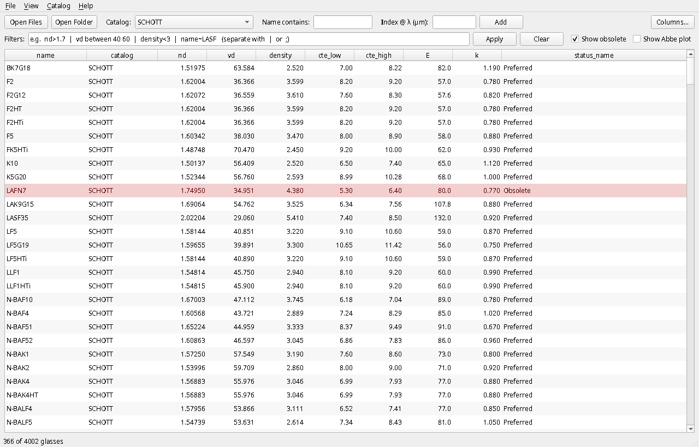
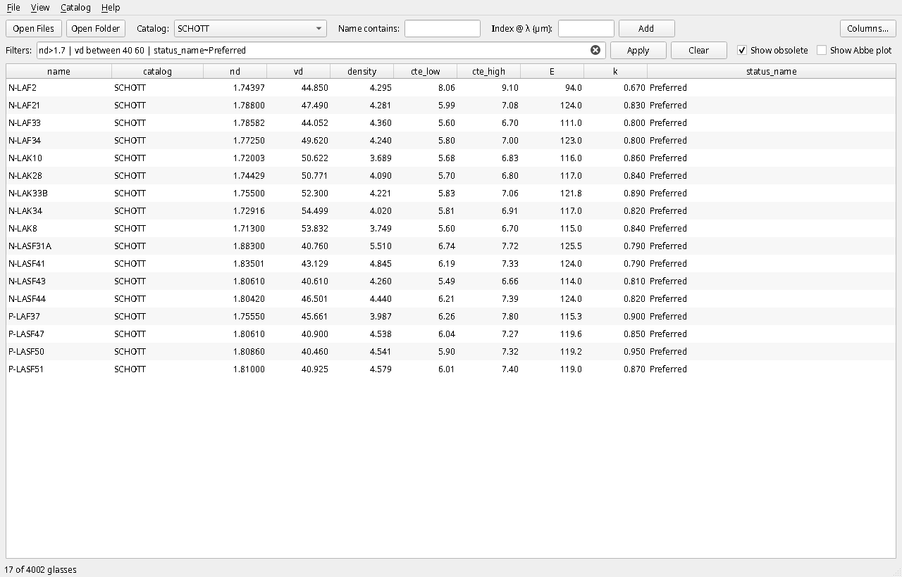
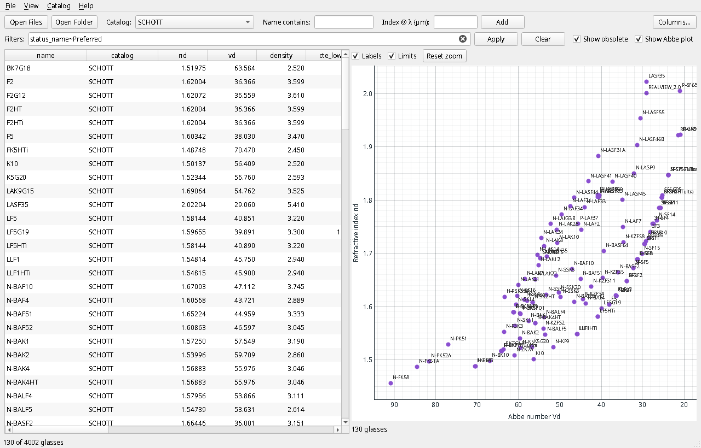
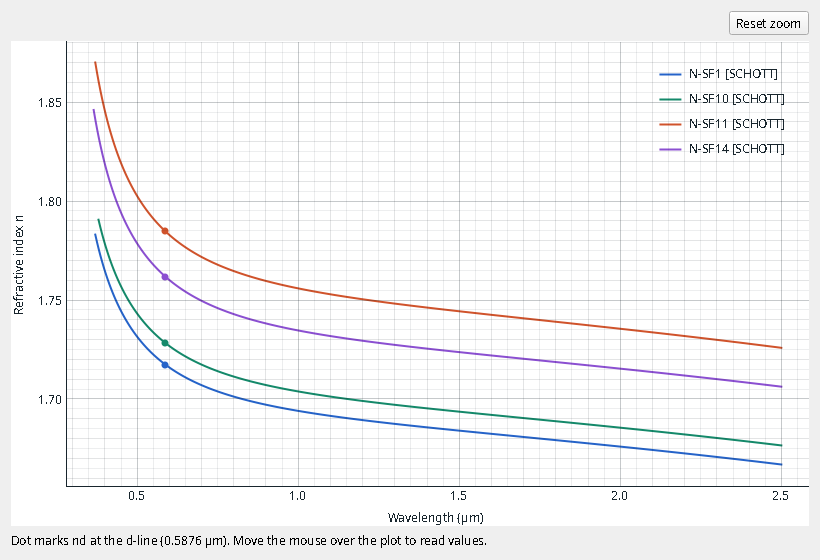

# sb_agf_catalog_explorer

**Browse, filter and plot Zemax OpticStudio glass catalogs (`.AGF`), without an OpticStudio licence.**

About 4000 glasses from 46 manufacturer catalogs are built in. Every glass is listed with its refractive index `nd`
and Abbe number `vd` (worked out from the glass's own dispersion formula), density, thermal expansion and its
mechanical, thermal and chemical data. Filter the list, plot the glass map and dispersion curves, and save the glasses
you pick as a catalog of your own.



---

## Download

Download the program for your system from the **[latest release](../../releases/latest)**:

| Platform | File | Notes |
|---|---|---|
| Windows 10 / 11 (64-bit) | [`sb_agf_catalog_explorer-windows-x64.exe`](../../releases/latest/download/sb_agf_catalog_explorer-windows-x64.exe) | one file, nothing to install |
| Linux (x86-64) | [`sb_agf_catalog_explorer-linux-x86_64`](../../releases/latest/download/sb_agf_catalog_explorer-linux-x86_64) | one file, nothing to install; built on a current distribution |

Each program is self-contained: the glass catalogs and everything else it needs are inside it. No Python, no
OpticStudio and no internet connection are needed. This guide is also available as a [PDF](README.pdf).

---

## Quick start

1. **Run it.**
   - **Windows:** double-click `sb_agf_catalog_explorer-windows-x64.exe`. The program isn't code-signed, so Windows
     SmartScreen may warn you the first time: click **More info ▸ Run anyway**.
   - **Linux:** make it executable once, then start it:
     ```
     chmod +x sb_agf_catalog_explorer-linux-x86_64
     ./sb_agf_catalog_explorer-linux-x86_64
     ```
   The first start takes a few seconds while the program unpacks itself; later starts are quicker.
2. **Search.** The window opens with all the built-in catalogs loaded. Pick one catalog from the **Catalog**
   drop-down, type part of a name into **Name contains**, or type a filter (below) and press Enter.
3. **Sort** by clicking a column header (again to reverse). **Columns…** chooses which properties are shown.
4. **Right-click** a glass for its full property sheet, its dispersion curve, or to add it to your custom catalog.
   Double-click copies the glass name.

### Your own catalogs

Use **File ▸ Open Files…** or **Open Folder…**, or drag `.AGF` files or a folder onto the window. They replace the
built-in catalogs while they're open. You can also give them on the command line:

```
sb_agf_catalog_explorer-windows-x64.exe C:\path\to\catalogs
./sb_agf_catalog_explorer-linux-x86_64 SCHOTT.AGF OHARA.AGF
```

---

## Filtering



Type expressions into the **Filters** box and press Enter. Separate several with `|` or `;`; **all of them have to
match**.

| Kind | Examples |
|---|---|
| Numeric | `nd>1.7`  `density<3`  `cte_low<=7` |
| Range | `vd between 40 60` |
| Text (contains, any case) | `name~LASF`  `catalog~SCHOTT`  `status_name~Standard` |

Operators: `>` `>=` `<` `<=` `==` `!=` `~` `between`. Filters work on any property, shown or not. Hover a column
header to see what it means; **Help ▸ Filter Help** has a short summary. **Show obsolete** hides or shows glasses
with Obsolete status (tinted red).

Some properties: `name`, `catalog`, `nd`, `vd`, `density`, `cte_low`, `cte_high`, `dPgF`, `E`, `nu`, `HK`, `cp`,
`k`, `cost`, `CR`, `FR`, `SR`, `AR`, `PR`, `lambda_min`, `lambda_max`, `formula_name`, `status_name`.

**Index at another wavelength:** type a wavelength in µm into **Index @ λ** and press **Add**: an `n@<µm>` column
appears and can be filtered and sorted like any other.

---

## Plots

**Glass map:** tick **Show Abbe plot** for nd against Vd of the glasses in the table, coloured by catalog. Filtering
narrows the plot too. Scroll to zoom, drag to pan, hover a point for its values, click it to find its row.



**Dispersion:** select one or more glasses, right-click ▸ **Plot dispersion**. Each glass is drawn over its own valid
wavelength range; the dot marks nd at the d-line.



---

## Custom catalogs

Pick glasses from any of the loaded catalogs and save them as a new `.AGF` that OpticStudio can load:

1. Select glasses in the table (Ctrl-click / Shift-click for several).
2. **Catalog ▸ Add selected to custom catalog** (or right-click, or **Ctrl+D**).
3. The first time, give a file name (leave it blank for `custom_<date>_<time>.AGF`).

Each glass is copied exactly as it is in its catalog, with all its data. Later additions go into the same file and
duplicates are skipped. With the built-in catalogs the file is saved in your **Documents** folder; with catalogs you
opened from a folder of your own, next to them. **Catalog ▸ Show custom catalog location** tells you where it is.

## Export

**File ▸ Export view to CSV… / Excel…** saves exactly what the table shows: filtered, sorted, with the chosen columns.

---

## Good to know

- **Where it unpacks:** the program unpacks itself once and reuses that on later starts:
  `%LOCALAPPDATA%\sb_agf_catalog_explorer\` on Windows, `~/.cache/sb_agf_catalog_explorer/` on Linux (about
  250 MB). A newer version removes the older one's files there by itself. Deleting the folder is safe: the next start
  unpacks again.
- **Settings:** your chosen columns and the window size are remembered between sessions.
- **Linux:** the program needs a reasonably recent distribution (it was built on a current one). If it doesn't start
  from the file manager, run it from a terminal to see why.
- **Windows Defender** sometimes flags new unsigned programs packed into one file; this is a false alarm.

---

## Support and terms

If sb_agf_catalog_explorer is useful in your work, please consider supporting its development at
[buymeacoffee.com/shailen001](https://buymeacoffee.com/shailen001) (also under **Help ▸ About**). More from the
author: [github.com/shailen001](https://github.com/shailen001), including
[sb_zmx_viewer](https://github.com/shailen001/sb_zmx_viewer), a viewer for Zemax OpticStudio lens designs.

The program is provided free of charge, as is, without warranty of any kind. The glass data are the manufacturers'
own catalogs, as distributed for OpticStudio.

Zemax and OpticStudio are trademarks of Ansys, Inc. sb_agf_catalog_explorer is an independent program, not
affiliated with or endorsed by Ansys or Zemax.
